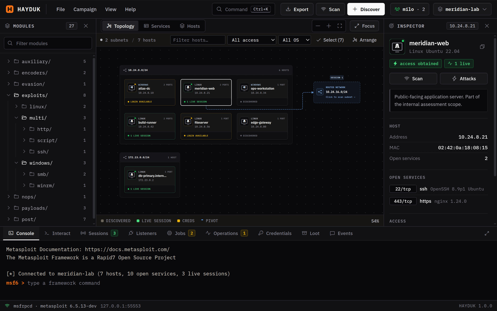
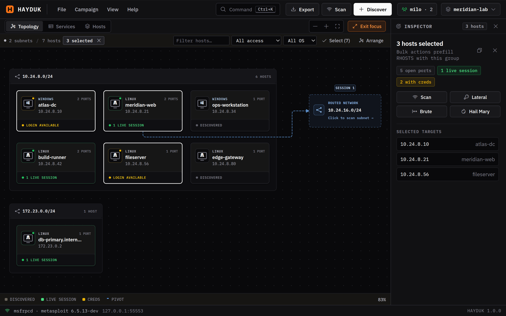
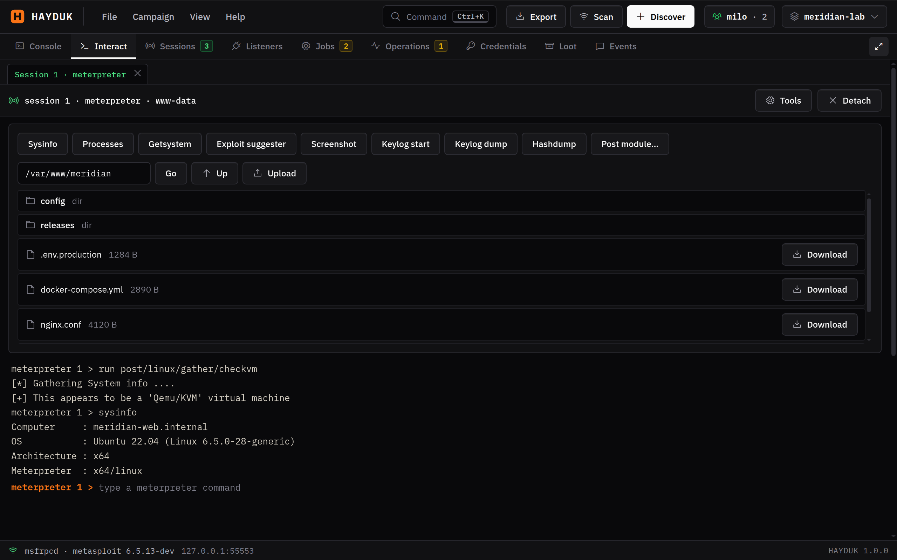

# Hayduk — Open-Source Metasploit GUI & Armitage Alternative

[](https://github.com/jolovicdev/hayduk/actions/workflows/ci.yml)
[](https://github.com/jolovicdev/hayduk/releases)
[](LICENSE)

Hayduk is a free, open-source **Metasploit GUI** and browser-based **Armitage alternative** for authorized penetration testing. It connects to Metasploit Framework over `msfrpcd` and gives you one web UI for network topology, module launching, Meterpreter and shell sessions, pivoting, multi-operator team campaigns, and HTML reporting.

It ships as a single static Go binary with the browser frontend embedded. Prebuilt `amd64` and `arm64` archives are published for Linux (including Kali Linux and Ubuntu), macOS, and Windows. No Java, Node.js, or Go runtime is required to run a release binary.

Hayduk is a client for `msfrpcd` and does not bundle Metasploit Framework.

**[Website (hayduk.dev)](https://hayduk.dev)** · **[Download latest release](https://github.com/jolovicdev/hayduk/releases/latest)** · [Quickstart](#quickstart) · [Docker lab](#try-the-docker-lab) · [Team mode](#team-mode) · [FAQ](#faq)



*Illustrative campaign data.*

## Quickstart

You need a Hayduk release binary, a browser, and a running Metasploit Framework instance. Workspace tables (hosts, services, credentials, loot) also require Metasploit's PostgreSQL database to be running (`msfdb init` / `msfdb start` on Kali Linux).

If you do not have Metasploit running yet, use the included [Docker lab](#try-the-docker-lab).

### 1. Start Metasploit RPC (`msfrpcd`)

On the machine running Metasploit:

```bash
msfrpcd -P 'yourpassword' -S -f -a 127.0.0.1 -p 55553
```

Replace `yourpassword` with your own password and keep this terminal open. `-a 127.0.0.1` restricts RPC to localhost; `-S` disables SSL for this local link.

### 2. Download and run Hayduk

Download the release archive for your OS and architecture from [GitHub Releases](https://github.com/jolovicdev/hayduk/releases/latest), extract it, and run the binary:

```bash
./hayduk
```

Hayduk starts a local server on a random port, prints a one-time token URL, and opens the Metasploit web UI in your browser. If the browser does not open automatically, paste the printed `http://127.0.0.1:<port>/?token=...` link into your browser.

### 3. Connect to `msfrpcd`

Enter your RPC settings in the connect dialog:

| Field | Value |
|---|---|
| Host | `127.0.0.1` |
| Port | `55553` |
| User | `msf` |
| Password | The password set in step 1 |
| Use SSL | Unchecked (matches `-S`) |

A cold Metasploit daemon takes roughly 15–30 seconds to respond. Successful connection profiles (without passwords) are saved locally for quick reconnect unless `--no-persist` is set.


*Demo recorded with illustrative campaign data.*

## Features

| Area | Details |
|---|---|
| **Network topology map** | Hosts grouped by subnet with OS icons (Windows, Linux, macOS, Android), open port counts, live workspace filtering (host, port, service, access, OS), Shift-click and marquee multi-select with bulk actions, drag/zoom/Focus mode, and clickable routed subnets. |
| **Module browser & `Ctrl+K` palette** | Instant search across hosts, sessions, actions, and 7,000+ Metasploit modules with reliability ranks, cached metadata, safe pre-launch **Check target** verdicts, option forms, and compatible payload selection. |
| **Service fingerprinting & operations** | Host discovery, `db_nmap -sV` version detection, login brute force, and rank-prioritized **Find Attacks** and **Hail Mary** runs executing as tracked background operations with live progress and cancellation. |
| **Meterpreter & shell session manager** | Multi-tab interactive consoles in **Interact**, a structured **Remote File Browser** with browser uploads/downloads and inline screenshot previews, one-click Meterpreter tools, compatible **Post module** streaming, and `shell_to_meterpreter` upgrades. |
| **Payload generation & web delivery** | Generate payloads directly over RPC and download binaries straight to the browser, or launch `exploit/multi/script/web_delivery` (Python, PHP, PowerShell, Regsvr32, Linux, macOS) with ready-to-copy one-liners tracked in **Listeners**. |
| **Pivoting** | Tabbed **Pivot** dialog (`Routes`, `SOCKS`, `Port forwards`) on any live session. Added routes appear on the topology map as clickable subnets that prefill service scans. |
| **Credentials, lateral movement & workspaces** | Inspect workspace credentials and loot, run targeted **Login / Lateral** workflows (SMB PsExec, SSH exec, WinRM, and Pass the Hash with NTLM hashes), and create, switch, or delete Metasploit workspaces from the header menu. |
| **Multi-operator team mode** | Share one `msfrpcd` campaign across multiple operators with private consoles, shared session transcripts, attributed events, team chat, optional TLS, and bound per-operator tokens. |
| **Offline HTML reports** | Export a self-contained, print-ready HTML campaign report scoped to the active workspace. Zero external requests; team chat is excluded automatically. |



*Topology Focus mode and multi-host selection with illustrative campaign data.*



*Meterpreter Tools panel with remote file browser and live session output (illustrative campaign data).*

## Hayduk vs Armitage

Hayduk follows the graphical Metasploit workflow established by [Armitage](https://github.com/rsmudge/armitage) (network map, module tree, sessions, Hail Mary, team campaigns) as a separate codebase:

| | Hayduk | Armitage |
|---|---|---|
| **Runtime** | Single Go binary + browser UI | Java desktop application (requires JVM) |
| **Connection** | Talks directly to `msfrpcd` via [go-msf](https://github.com/jolovicdev/go-msf) | Java teamserver wrapper around `msfrpcd` |
| **Team mode** | Built-in `--team` with private consoles, shared transcripts, optional TLS (`--tls-cert`), and bound tokens (`--operator`) | Dedicated `teamserver` script over SSL |
| **Reporting** | Self-contained offline HTML report (printable to PDF) | Text / activity logs |
| **License** | MIT | BSD |

## Keyboard shortcuts

| Shortcut | Action |
|---|---|
| `Ctrl+K` | Open command palette (modules, hosts, sessions, actions) |
| `1` / `2` / `3` | Switch between Topology, Services, and Hosts |
| `[` / `]` | Toggle Modules and Inspector side panels |
| `F` | Fit the topology graph to the view |
| `Tab` | Autocomplete commands in the Metasploit console |
| `Esc` | Close menus and dialogs |

## Try the Docker lab

The repository includes a disposable Metasploit + PostgreSQL lab with optional vulnerable target containers for testing discovery, scanning, pivoting, and report export locally:

```bash
git clone https://github.com/jolovicdev/hayduk.git
cd hayduk
scripts/msf/up.sh --with-vulnbox
```

Start Hayduk with the shared staging directory and connect to `127.0.0.1:55553` with user `msf`, password `testpass123`, and **Use SSL** unchecked. Omit `--with-vulnbox` to start only Metasploit and PostgreSQL.

```bash
./hayduk --staging-dir /tmp/hayduk-staging
```

`scripts/msf/up.sh` creates and bind-mounts `/tmp/hayduk-staging` (overridable via `HAYDUK_STAGING`) so browser file transfers and screenshots work against the containerized daemon, and forwards ports `4444-4450` (handlers) and `8080-8085` (web delivery).

Remove the containers and volumes when finished:

```bash
scripts/msf/down.sh
```

## Team mode

Run Hayduk with `--team` on an explicit non-loopback interface address your team can reach (wildcard binds such as `0.0.0.0` are refused):

```bash
./hayduk --team --listen 192.168.1.10:8787
```

For HTTPS and verified per-operator identities, pass a PEM certificate/key pair and repeatable `--operator name=token` flags (each token must be unique and at least 16 characters):

```bash
./hayduk --team --listen 192.168.1.10:8787 \
  --tls-cert server.crt --tls-key server.key \
  --operator milo=<16+ char secret> \
  --operator ana=<16+ char secret>
```

How shared campaigns behave:

- **One shared workspace.** Every operator sees the same hosts, services, credentials, loot, operations, listeners, sessions, and pivot routes.
- **Private consoles.** Each operator gets an isolated Metasploit console; commands and output do not mix across operators.
- **Shared session transcripts.** Operators attach and detach session tabs independently while sharing live output and history.
- **Attributed event log & team chat.** Actions record which operator ran them. Team chat stays in the **Events** dock and is stripped from exported HTML reports.

See [SECURITY.md](SECURITY.md) for the full trust model and HTTP security headers.

## CLI flags

| Flag | Default | Description |
|---|---|---|
| `--listen` | `127.0.0.1:0` | `host:port` to bind (explicit non-loopback address required with `--team`) |
| `--team` | `false` | Enable multi-operator shared campaign mode |
| `--operator` | *(none)* | Repeatable `name=token` binding an operator identity (team mode) |
| `--tls-cert` / `--tls-key` | *(none)* | Serve UI and WebSocket over HTTPS/WSS with `Secure` cookies |
| `--data-dir` | OS config dir | Directory for `events.jsonl`, rank cache, listener registry, and saved profiles |
| `--staging-dir` | auto (local) | Shared directory with `msfrpcd` for browser file uploads, downloads, and screenshots (defaults to a private temp dir on loopback) |
| `--no-persist` | `false` | Run in memory without writing state to disk |
| `--no-browser` | `false` | Do not open a browser window on startup |
| `--dev` / `--dev-upstream` | `false` / `127.0.0.1:5173` | Proxy UI requests to a Vite dev server during development |
| `--version` | `false` | Print version and exit |

## Troubleshooting

| Problem | What to check |
|---|---|
| Browser does not open | Open the full `/?token=...` URL printed in the terminal, or pass `--no-browser`. |
| Cannot connect to `msfrpcd` | Confirm `msfrpcd` is running and that host, port, username, password, and SSL match. |
| SSL error on connect | Uncheck **Use SSL** when `msfrpcd` runs with `-S`; enable it when `msfrpcd` uses TLS. |
| Empty hosts or services | Check the active workspace and confirm Metasploit's PostgreSQL database is connected (`db_status`). |
| Service version scan fails | Version detection runs `db_nmap`, which requires `nmap` and a connected database on the Metasploit host. Clear version detection to fall back to a portscan module. |

## FAQ

### Is Hayduk an Armitage alternative for Kali Linux?
Yes. Hayduk covers the same visual Metasploit workflow (host map, module browser, session consoles, pivoting, Hail Mary, and team campaigns) without Java or the legacy Armitage desktop client.

### Does Hayduk include Metasploit Framework?
No. Hayduk is a frontend client for `msfrpcd`. Point it at your local Metasploit install, a remote Metasploit host, or the included Docker lab.

### Can Hayduk connect to `msfrpcd` on another machine?
Yes. Enter the reachable IP or hostname of the Metasploit host in the connect dialog and match its RPC port, credentials, and SSL setting. Pure-RPC features including payload generation and directory browsing work directly; browser file uploads, downloads, and inline screenshots require a shared filesystem passed via `--staging-dir` (otherwise downloads and screenshots report where the file landed on the `msfrpcd` host).

### Do I need Go, Node.js, or Java to run Hayduk?
No. Release binaries are self-contained and embed the frontend. Go and Node.js are only needed to build from source.

### Is Hayduk free and open source?
Yes, licensed under MIT.

## Build from source

Requires Go 1.26+, Node.js 22/24, npm, and Make:

```bash
make
./bin/hayduk
```

Development and verification:

```bash
# Run Vite dev server + Go backend proxy
cd ui && npm run dev
make dev

# Run tests and checks
make test           # Go tests + Vitest UI suite
go test -race ./... # Full Go race detector pass
npm --prefix ui run lint
make gen-check      # Verify Go -> TypeScript protocol bindings (tygo)
make integration    # Requires the running Docker lab
```

## Credits and license

Hayduk draws on the graphical Metasploit workflow established by [Armitage](https://github.com/rsmudge/armitage) by Raphael Mudge and communicates with Metasploit through [go-msf](https://github.com/jolovicdev/go-msf).

Licensed under [MIT](LICENSE). See [docs/THIRD-PARTY-NOTICES.md](docs/THIRD-PARTY-NOTICES.md) for bundled fonts and icon licenses. Use only on systems you own or have written permission to test.
