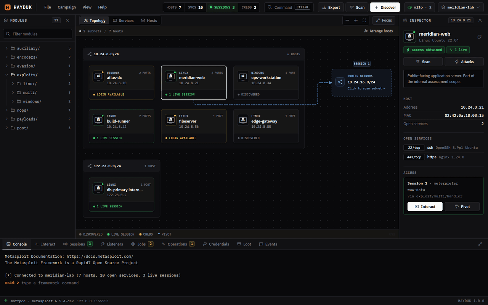

# Hayduk

[](https://github.com/jolovicdev/hayduk/actions/workflows/ci.yml)
[](https://github.com/jolovicdev/hayduk/releases)
[](LICENSE)

Open-source browser GUI for Metasploit (`msfrpcd`) and modern Armitage alternative. Ships as a single Go binary with the frontend embedded — no Java, Node.js, or Go runtime required.

Hayduk connects to an existing Metasploit Framework instance over `msfrpcd`. It does not bundle Metasploit.

[hayduk.dev](https://hayduk.dev) · [Latest release](https://github.com/jolovicdev/hayduk/releases/latest) · [Quickstart](#quickstart) · [Docker lab](#try-the-docker-lab) · [Team mode](#team-mode)


*Shown with illustrative campaign data.*

## Features

- **Network topology** — hosts grouped by subnet with OS icons (Windows, Linux, macOS, Android), open port counts, drag/zoom/Focus mode, and clickable routed subnets.
- **Modules & `Ctrl+K` command palette** — instant search across hosts, sessions, actions, and 7,000+ Metasploit modules, with reliability ranks, option forms, and payload selection.
- **Operations tracker** — host discovery, `db_nmap -sV` service fingerprinting, login brute force, and Hail Mary runs execute in the background with live progress and cancellation.
- **Sessions & pivoting** — multi-tab Meterpreter and shell consoles, Meterpreter tools (Sysinfo, Processes, Files, Screenshot, Keylog, Hashdump), shell upgrades, and a tabbed Pivot dialog (`Routes`, `SOCKS`, `Port forwards`).
- **Team mode** — shared `msfrpcd` campaign with per-operator private consoles, shared refcounted session transcripts, attributed events, internal team chat, optional TLS, and per-operator bound tokens.
- **Persistence & reporting** — local JSONL audit log, cached module ranks, listener registry, saved non-secret connection profiles, and plain print-ready HTML campaign reports (zero external requests).



## Quickstart

Requires a Hayduk release binary, a browser, and Metasploit Framework (`msfrpcd` + PostgreSQL for workspace tables). For a disposable practice setup, see [Docker lab](#try-the-docker-lab).

### 1. Start `msfrpcd`

```bash
msfrpcd -P 'yourpassword' -S -f -a 127.0.0.1 -p 55553
```

`-a 127.0.0.1` binds locally; `-S` disables SSL for this localhost link.

### 2. Run Hayduk

Download and extract the archive from [Releases](https://github.com/jolovicdev/hayduk/releases/latest):

```bash
./hayduk        # Linux / macOS
.\hayduk.exe    # Windows PowerShell
```

Hayduk opens the UI in your browser with a one-time token URL.

### 3. Connect

| Field | Value |
|---|---|
| Host | `127.0.0.1` |
| Port | `55553` |
| User | `msf` |
| Password | Password set in step 1 |
| Use SSL | Unchecked (for `-S`) |

Successful profiles (without passwords) are saved for quick reconnect.


## Keyboard shortcuts

| Shortcut | Action |
|---|---|
| `Ctrl+K` | Command palette |
| `1` / `2` / `3` | Topology / Services / Hosts |
| `[` / `]` | Toggle Modules / Inspector panels |
| `F` | Fit topology graph to view |
| `Tab` | Autocomplete console commands |
| `Esc` | Close menus and dialogs |

## Try the Docker lab

Spins up Metasploit, PostgreSQL, and optional vulnerable target containers:

```bash
git clone https://github.com/jolovicdev/hayduk.git
cd hayduk
scripts/msf/up.sh --with-vulnbox
```

Connect with host `127.0.0.1`, port `55553`, user `msf`, password `testpass123`, SSL off. Tear down with:

```bash
scripts/msf/down.sh
```

## Team mode

Bind to an explicit non-loopback interface address (wildcard addresses like `0.0.0.0` are refused):

```bash
./hayduk --team --listen 192.168.1.10:8787
```

With HTTPS and per-operator bound tokens (min 16 chars, unique):

```bash
./hayduk --team --listen 192.168.1.10:8787 \
  --tls-cert server.crt --tls-key server.key \
  --operator milo=<secret-token-1> \
  --operator ana=<secret-token-2>
```

Each operator gets a private Metasploit console while sharing hosts, services, sessions, transcripts, routes, and events. Team chat stays out of exported HTML reports. See [SECURITY.md](SECURITY.md) for the trust model.

## CLI flags

| Flag | Default | Description |
|---|---|---|
| `--listen` | `127.0.0.1:0` | `host:port` to bind (non-loopback required with `--team`) |
| `--team` | `false` | Enable multi-operator shared campaign mode |
| `--operator` | *(none)* | Repeatable `name=token` binding an operator identity (team mode) |
| `--tls-cert` / `--tls-key` | *(none)* | Serve UI and WebSocket over HTTPS/WSS with `Secure` cookies |
| `--data-dir` | OS config dir | Directory for `events.jsonl`, rank cache, listeners, and profiles |
| `--no-persist` | `false` | Disable all disk persistence |
| `--no-browser` | `false` | Do not open a browser window on startup |
| `--dev` / `--dev-upstream` | `false` / `127.0.0.1:5173` | Proxy UI requests to Vite during development |
| `--version` | `false` | Print version and exit |

## Build from source

Requires Go 1.26+, Node.js 22/24, npm, and Make:

```bash
make
./bin/hayduk
```

Checks:

```bash
make test           # Go + Vitest suites
go test -race ./... # Full Go race detector pass
npm --prefix ui run lint
make gen-check      # Verify Go -> TypeScript protocol bindings
make integration    # Requires Docker lab
```

## License & credits

MIT License — see [LICENSE](LICENSE) and [docs/THIRD-PARTY-NOTICES.md](docs/THIRD-PARTY-NOTICES.md). Inspired by [Armitage](https://github.com/rsmudge/armitage) by Raphael Mudge; connects to Metasploit via [go-msf](https://github.com/jolovicdev/go-msf). Use only on systems you own or have written authorization to test.
